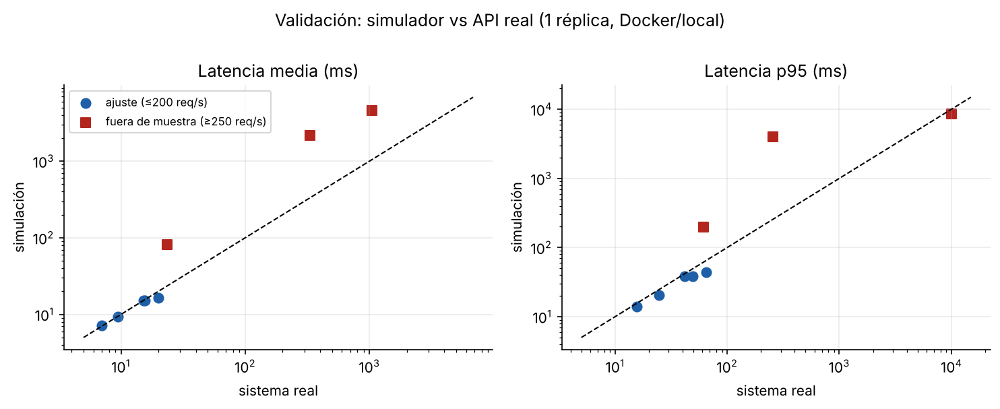
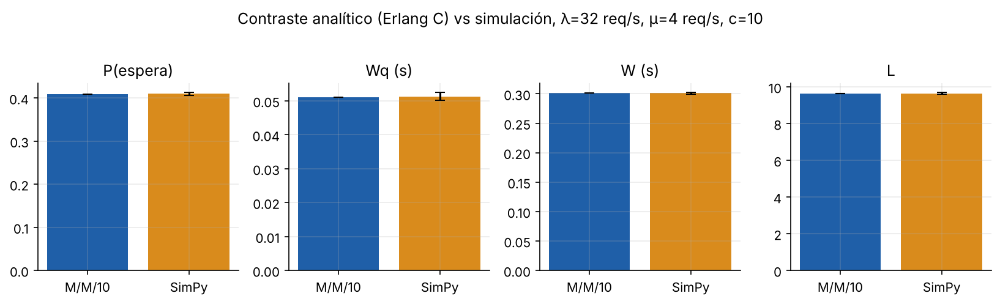
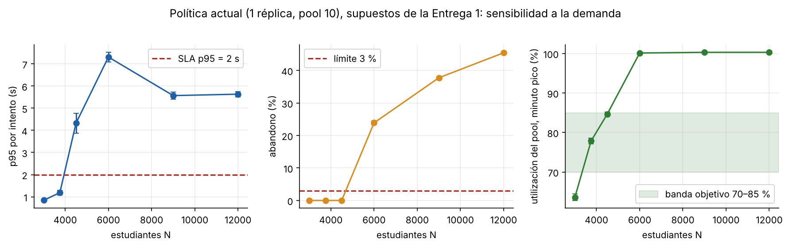
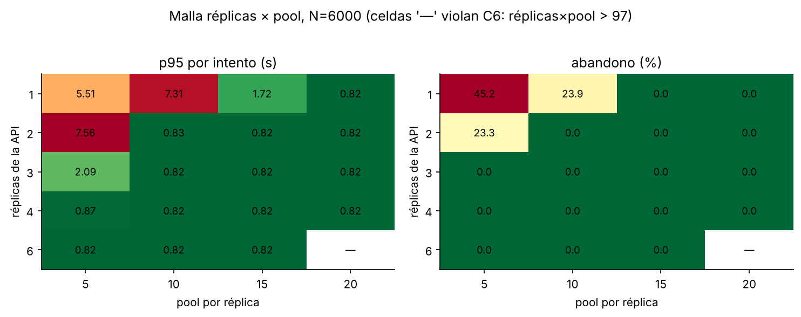
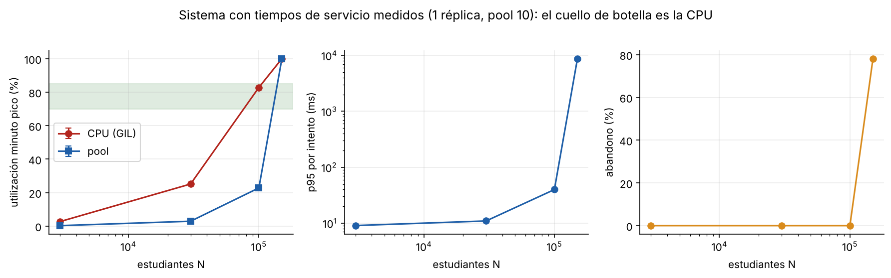
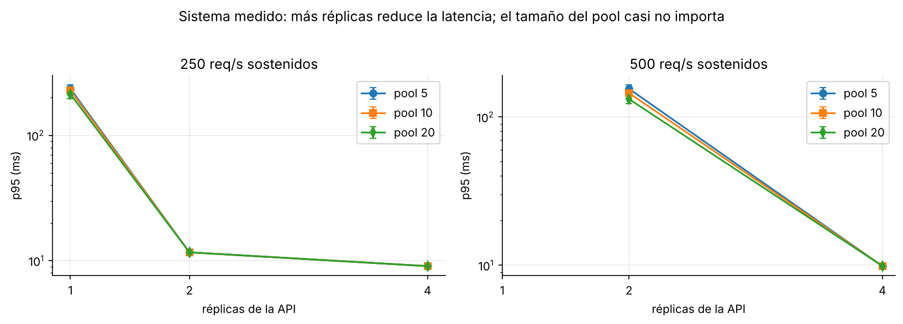
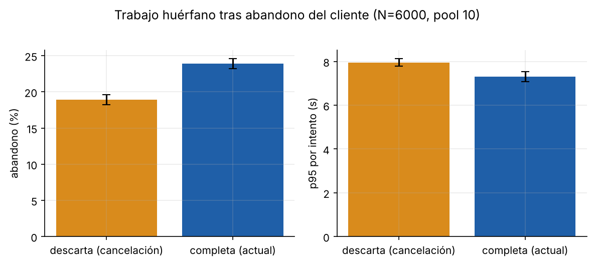

# Informe Final — Plataforma de Matrículas Académicas

- **Curso:** Modelos y Simulación (2026-2) — I.U. Pascual Bravo
- **Grupo:** Grupo 4
- **Repositorio:** https://github.com/samuel-311-ui/Plataforma_matriculas
- **Comando de despliegue API:** `docker compose up --build -d`
- **Comando de ejecución SimPy:** `python simulacion/main.py`

| Integrante | Correo Institucional | Rol Ejecutado | Commits Principales (Módulos) |
| :--- | :--- | :--- | :--- |
| Samuel Zapata | samuel.zapata599@pascualbravo.edu.co | Modelado DES / SimPy | `api/`, `docker-compose.yml` |
| Simón Restrepo | simon.restrepo405@pascualbravo.edu.co | Infraestructura / API / Telemetría |  `docs/` |
| Felipe Hurtado | felipe.hurtado796@pascualbravo.edu.co | Análisis Estadístico / Contraste M/M/c | `analisis/`, `datos/`, `simulacion/` |

## 1. Resumen Ejecutivo

Una plataforma de matrícula recibe picos de solicitudes que compiten por los hilos de la API, las conexiones a PostgreSQL y la CPU del proceso Python. Construimos un prototipo contenerizado (Streamlit + FastAPI + PostgreSQL) con telemetría por petición, calibramos con ella un modelo SimPy y lo validamos contra la API real (diferencia de la latencia media ≤ 3 % en cuatro de cinco corridas hasta 200 req/s).

## 2. Contexto del Sistema y Subsanación de la Entrega 1

### 2.1 Dinámica del Sistema (Qué fluye, qué espera, qué se satura)

**Entidades que fluyen.** Solicitudes HTTP de estudiantes. Cada estudiante consulta asignaturas (`GET /asignaturas`), piensa en promedio 20 s (lognormal, cv 0.5) y con probabilidad 0.6 matricula (`POST /matriculas`). También existen `GET /estudiantes`, `GET /matriculas`, `DELETE /matriculas?matricula_id=ID`, registros y `GET /health`.

**Recursos y colas.**

| Recurso | Capacidad en el código | Disciplina |
| :--- | :--- | :--- |
| Hilos de atención por réplica | 40 (threadpool de FastAPI) | FIFO |
| CPU de Python por réplica | 1 efectiva (el GIL serializa el código) | FIFO |
| Pool de conexiones por réplica | `DB_POOL_SIZE = 10` | espera hasta `DB_POOL_TIMEOUT = 10 s`; luego error 500 |
| Conexiones extra | `DB_MAX_OVERFLOW = 0` | no hay |
| Conexiones de PostgreSQL | `max_connections = 100` (97 utilizables) | rechazo al agotarse |
| Fila de la asignatura | 1 por asignatura | el `UPDATE` de cupos serializa matrículas de la misma asignatura |

**Límite físico duro (C6).** réplicas × (`DB_POOL_SIZE` + `DB_MAX_OVERFLOW`) ≤ 97. La malla de la sección 5 solo incluye configuraciones que lo cumplen.

**Comportamiento de agentes (C7).** El cliente abandona cada intento tras T = 10 s, reintenta hasta k = 3 veces con pausa exponencial de media 5 s y, agotados los reintentos, el estudiante abandona.

### 2.2 Tabla de Subsanación de la Entrega Parcial 1

| Observación / Error en Entrega 1 | Corrección Implementada en la Entrega Final | Archivo / Línea en el Repositorio |
| :--- | :--- | :--- |
| No había simulación SimPy funcional: una sola cola, λ = 1 req/s fija y servicio de 0.30 s inventado, sin relación con la telemetría. | Modelo de tres etapas (hilos, CPU, pool) con tiempos remuestreados de la telemetría real, llegadas por perfiles, timeouts, reintentos y abandono. | `simulacion/modelo.py`, `simulacion/config.py` |
| La telemetría solo guardaba la duración total; no separaba espera de servicio. | Se registran `pre_ms` (hasta obtener conexión) y `hold_ms` (conexión retenida) con eventos del pool; un hilo aparte escribe el CSV. | `api/telemetria.py`, `datos/telemetry_log.csv` |
| Parámetros del código y del documento no coincidían (`max_connections` 20 vs 100, pool 5 vs 10, timeout 30 s vs 10 s). | Se alinearon: pool 10, overflow 0, timeout 10 s, `max_connections = 100`. | `docker-compose.yml`, `api/database.py` |
| Las tablas 6 y 8 de la Entrega 1 daban perfiles de llegada distintos (40 % en el primer minuto frente a 70 % en 10 min). | Se simulan ambos perfiles (`pico60` y `tabla8`); el pico de λ = 32 req/s de la tabla 6 es el escenario base. | `simulacion/modelo.py` (`tiempos_llegada`) |
| Los tiempos de servicio de la Entrega 1 (0.15 s y 0.40 s) eran supuestos; la API real responde en milisegundos. | Se simulan dos mundos, «E1» (supuestos) y «medido» (telemetría), y se reportan ambos. | `simulacion/main.py` |
| La Ley de Little no estaba verificada. | Se verifica L = λW en cada réplica y en el M/M/10 estacionario (sección 4). | `analisis/contrast_analysis.py` |
| Cifras escritas a mano en los scripts de análisis (por ejemplo 0.748). | Todo se calcula desde `simulacion/resultados/*.csv`. | `analisis/` |
| Faltaban N ≥ 30 réplicas e IC 95 %. | 30 réplicas, semillas 42..71, IC 95 % con t de Student. | `simulacion/config.py` |

## 3. Arquitectura del Prototipo, Telemetría y Parámetros Calibrados

### 3.1 Resumen de Telemetría del Sistema Real Contenerizado

Se despliega con `docker compose up --build -d`: Streamlit (:8501) → FastAPI (:8000) → PostgreSQL 16 (:5432). El middleware `medir_tiempo` y los eventos `checkout`/`checkin` del pool de SQLAlchemy escriben una fila por petición en `datos/telemetry_log.csv`, con `duration_ms`, `pre_ms` y `hold_ms`; un hilo independiente hace la escritura para no sumar latencia.

Para calibrar se ejecutaron 3000 consultas y 3000 matrículas en serie (concurrencia 1, sin congestión) con `datos/generar_carga.py calibrar`. Se midió además el tiempo de CPU del proceso (`datos/medir_cpu.py`): 2.40 ms por consulta y 3.93 ms por matrícula. Para validar se aplicaron llegadas Poisson de 100 a 350 req/s (8 corridas, `datos/real/`).

Limitaciones: la API, PostgreSQL y el generador de carga compartieron la misma máquina; la duración medida no incluye la latencia de red; y el generador (Python) no logra ofrecer 300 req/s o más completos.

### 3.2 Parámetros y Distribuciones de Entrada del Modelo SimPy

| Parámetro | Etapa / Proceso | Distribución y Parámetros Exactos | Unidad | Fuente / Evidencia |
| :--- | :--- | :--- | :--- | :--- |
| Llegadas de estudiantes (perfil `pico60`) | Entrada | 40 % U[0, 60] s; 60 % exp(τ = 1800 s); N = 3000 | s | Entrega 1, tabla 6 (λ ≈ 32 req/s en el primer minuto) |
| Llegadas (perfil `tabla8`) | Entrada | 70 % U[0, 600] s; 30 % exp(τ = 1800 s) | s | Entrega 1, tabla 8 |
| Tiempo de pensar | Entre pasos | Lognormal, media 20 s, cv 0.5 | s | Entrega 1 |
| Prob. de matricular | Decisión | 0.6 | — | Entrega 1 |
| Etapas 1-2: validación y enrutamiento (`pre`) | CPU | Remuestreo empírico; media 1.11 ms (consulta), 1.22 ms (matrícula) | ms | `datos/telemetry_log.csv` |
| Etapa 3: conexión retenida (`hold`) | Pool | Remuestreo empírico; media 2.57 ms (consulta), 4.90 ms (matrícula); 50 % y 55 % es CPU | ms | `datos/telemetry_log.csv`, `datos/cpu_por_peticion.json` |
| Inflación de CPU por contención κ | CPU | 1.3 (ajustada) | — | `simulacion/ajustar_kappa.py` |
| Timeout del cliente / reintentos / pausa | Cliente | 10 s / k = 3 / exp(5 s) | s | Entrega 1 |
| Timeout de espera por conexión | Pool | 10 s | s | `api/database.py` |
| Tiempos de servicio «E1» | Pool | Exponencial, media 0.15 s (consulta), 0.40 s (matrícula) | s | Entrega 1 (supuesto) |

**Validación contra el sistema real.** κ se ajustó con las cinco corridas de hasta 200 req/s. Con κ = 1.3 el simulador reproduce la latencia media real con diferencias entre −3 % y +3 % en cuatro de las cinco corridas, y −18 % en la de pool 2 a 200 req/s (16.4 ms frente a 20.0 ms); el p95 simulado queda 7–31 % por debajo del real. Fuera de muestra (250 a 350 req/s) el modelo ubica la rodilla de saturación (unos 259 req/s por réplica).

## 4. Diseño Experimental y Contraste Analítico (M/M/c vs. SimPy)

- **Horizonte simulado:** 2 h (7200 s). Las llegadas se limitan a ese horizonte y el sistema se simula hasta vaciarse.
- **Calentamiento:** 300 s en el contraste M/M/10. Las corridas por estudiantes parten de un sistema vacío porque el pico inicial es parte del fenómeno.
- **Réplicas independientes:** 30, semillas `42..71`.
- **Métricas:** p95 y p99 del tiempo de respuesta por intento exitoso, abandono por estudiante, utilización del recurso en el minuto más cargado y error de Little.

### 4.1 Tabla de Validación Analítica (Régimen Estacionario Exponencial)

M/M/10 con λ = 32 req/s, μ = 4 req/s (ρ = 0.80), servicio exponencial, sin abandonos ni reintentos, 3600 s por réplica.

| Métrica | Modelo Analítico M/M/c | SimPy Modo Markoviano (Media ± IC 95 %) | Diferencia Relativa (%) |
| :--- | :---: | :---: | :---: |
| Utilización (ρ = λ/cμ) | 0.8000 | 0.8008 ± 0.0010 | 0.10 |
| P(espera) | 0.4092 | 0.4099 ± 0.0034 | 0.17 |
| Longitud media de cola (Lq) | 1.637 | 1.642 ± 0.045 | 0.33 |
| Tiempo medio de espera en cola (Wq) | 0.0511 s | 0.0513 ± 0.0013 s | 0.31 |
| Tiempo medio en el sistema (W) | 0.3011 s | 0.3012 ± 0.0014 s | 0.02 |
| Solicitudes en el sistema (L) | 9.637 | 9.651 ± 0.051 | 0.14 |

El valor teórico cae dentro del IC 95 % en todas las métricas (figura 2).

**Ley de Little.** En el M/M/10 estacionario, L simulado = 9.651 y λ·W = 9.649; el error relativo máximo entre las 30 réplicas es 0.03 %. En los escenarios con estudiantes, L y λ·W coinciden al 0.000 %, porque se mide sobre toda la corrida hasta vaciar el sistema (`analisis/contrast_analysis.py`).

**Análisis de divergencia al activar la dinámica real.** Con el perfil real el modelo deja de parecerse al M/M/10. La llegada es una ráfaga transitoria (40 % en el primer minuto), no un flujo constante: el pool pasa de estar casi vacío a saturarse y vuelve a vaciarse. Con N = 3000 el p95 por intento es 0.84 s, casi tres veces el W teórico de 0.30 s, porque la cola se forma durante la ráfaga; la utilización del minuto pico es 63.6 %, menor que el 80 % estacionario. Con N = 6000 la demanda supera la capacidad (λ pico ≈ 64 req/s frente a 40 req/s)

## 5. Resultados de la Simulación y Evaluación de Políticas de Decisión

### 5.1 Comparación Cuantitativa de Escenarios

Escenario de estrés: N = 6000 estudiantes, perfil `pico60`, supuestos «E1», 30 réplicas. Los p95 y p99 son por intento.

| KPI (con unidad) | Umbral SLA | Política Actual: 1 réplica, pool 10 (Media ± IC 95 %) | Alternativa 1: 1 réplica, pool 15 | Alternativa 2: 2 réplicas, pool 10 |
| :--- | :---: | :---: | :---: | :---: |
| Tiempo de respuesta p95 (s) | < 2.0 | 7.31 ± 0.23 | 1.72 ± 0.24 | 0.83 ± 0.01 |
| Tiempo de respuesta p99 (s) | — | 9.43 ± 0.07 | 2.30 ± 0.26 | 1.43 ± 0.01 |
| Tasa de abandono (%) | < 3.0 | 23.90 ± 0.67 | 0.00 ± 0.00 | 0.00 ± 0.00 |
| Utilización del pool, minuto pico (%) | 70–85 | ≈ 100 (saturado) | 81.5 ± 0.6 | 64.8 ± 0.7 |
| Conexiones a PostgreSQL (límite 97) | ≤ 97 | 10 | 15 | 20 |
| ¿Cumple SLA? | | No | Sí (p95 con poco margen) | Sí (utilización bajo la banda) |

Con N = 3000 (Entrega 1) la política actual cumple: p95 = 0.84 ± 0.01 s, p99 = 1.44 ± 0.02 s, abandono 0 % y utilización 63.6 ± 0.8 %.

La malla completa (figura 4 y `simulacion/resultados/tablas.md`) muestra que, lo que importa es el total de conexiones (réplicas × pool): con 20 o más todas las combinaciones cumplen el SLA a N = 6000; con 10 se pierde 23–24 % de los estudiantes; y con 5 conexiones (1 réplica, pool 5) el abandono llega a 45 %.

### 5.2 Análisis de las Preguntas de Decisión

**Pregunta 1: ¿la política actual soporta el pico?** Soporta el pico de la Entrega 1 (N = 3000), pero con poco margen frente al crecimiento. Con N = 3750 el p95 es 1.19 s y la utilización 77.9 % (dentro de la banda); con N = 4500 el p95 ya es 4.33 s (incumple); y con N = 6000 el abandono supera 23 %. El p95 no sube de forma monótona para N ≥ 6000 porque solo se mide sobre los intentos que terminan (los demás son abandonos), por eso el indicador que decide es el abandono (figura 3). El desacuerdo entre las tablas 6 y 8 de la Entrega 1 pesa mucho: con el perfil de la tabla 8 el pico sería de unos 5.6 req/s y no de 32 req/s.

**Pregunta 2: ¿cuál es el cuello de botella y qué palanca conviene?** Depende de qué tiempos de servicio sean ciertos. Con los supuestos de la Entrega 1 (0.15–0.40 s en la base de datos) el cuello es el pool y la palanca es el total de conexiones. Con los tiempos medidos (3 a 5 ms por petición) la base de datos casi no trabaja: con N = 100 000 el pool está al 22.8 ± 0.3 % de utilización pico mientras la CPU de la réplica llega a 82.8 ± 0.2 %, y con 150 000 estudiantes la réplica se satura (abandono 78 %).

## 6. Recomendación de Ingeniería y Declaración de Uso de IA

### 6.1 Recomendación Técnica Final

Desplegar **2 réplicas de la API con `DB_POOL_SIZE = 10` y `DB_MAX_OVERFLOW = 0`** (20 conexiones, muy por debajo de las 97 permitidas), con un balanceador que reparta entre réplicas. Es la única configuración evaluada que cumple a la vez el p95 (0.83 s), el abandono (0 %) y la restricción C6, y resiste en ambos mundos: duplica el recurso que limita según los supuestos de la Entrega 1 (conexiones) y según la medición (CPU de Python). Con el sistema medido sostiene 500 req/s con p95 de unos 145 ms, mientras que una sola réplica deja de responder. Su utilización pico (64.8 %) queda algo bajo la banda de 70–85 %: es capacidad de reserva, no un incumplimiento. La alternativa de una réplica con pool 15 sí está en la banda (81.5 %), pero su p95 (1.72 ± 0.24 s) queda cerca del umbral.

Antes de producción conviene: (1) repetir la calibración con la API detrás del balanceador y con latencia de red real; (2) medir tiempos de matrícula con contención de cupos en pocas asignaturas, que aquí se evitó con cupos casi ilimitados (supuesto S3); (3) decidir si el servidor debe cancelar el trabajo cuando el cliente abandona (con N = 6000 baja el abandono de 23.9 % a 18.9 %, pero no elimina la saturación).

**Limitaciones.** La validación fuera de muestra es solo cualitativa; el generador de carga se satura antes que la API; el modelo no incluye contención por bloqueo de filas ni la red; y el perfil de llegadas de la Entrega 1 es ambiguo, por lo que el resultado cuantitativo depende de él.

### 6.2 Declaración de Uso de Inteligencia Artificial

| Herramienta de IA | Módulos donde se utilizó | instrucción/prompt dado |
| :--- | :--- | :--- |
| Claude | api/telemetria.py, datos/generar_carga.p, simulacion/, redacción del formato md | Ayúdame diciendo paso a paso la estructura de las carpetas para generar la simulación y que datos e información debo ingresar para que esta se pueda llevar a cabo |
| Chatgpt | simulacion/, analisis/, fórmulas de earlang, ley de little | Según las formulas de la teoría de colas, la ley de little y earlang, me puedes decir si la simulación en nuestra api si las lleva a cabo, o que podemos mejorar para que se cumpla |
| Claude | api/telemetria.py, datos/generar_carga.py, analisis/, redacción de este informe | Ayudame diciendome que comandos debo ejecutar en la terminal para poder llevar a cabo esta simulación. Dime como puedo pasar el INFORME_FINAL a formato md, sin dañar la visualización del texto y que nada quede sin poder verse bien |
| Gemini | figuras/ | Me puedes ayudar con un paso a paso, de como con la libreria de python podemos mostrar en la carpeta figuras los resultados de la simulación y con que comandos se puede llevar a cabo|
